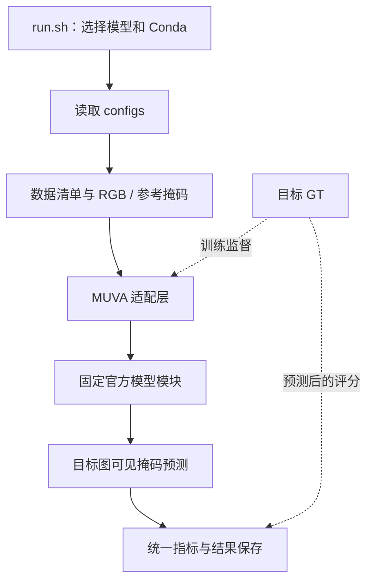
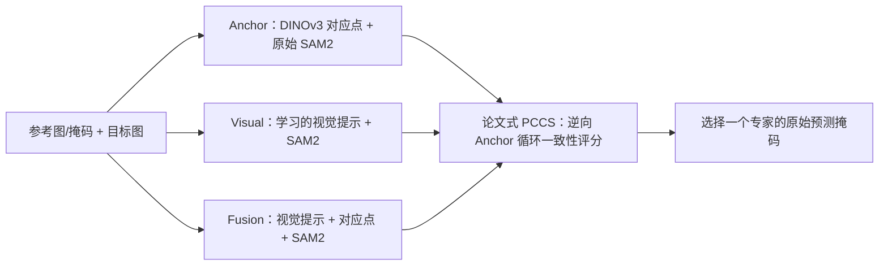

# 项目架构与模型代码导读

更新：2026-11-18。本文按当前固定版本的实际代码梳理，适合先了解数据流，再追踪网络模块。阅读入口统一为 `/root/repos/MUVA-VGGTS-EXAM`；本次只整理说明，没有修改网络或正在运行的训练。

## 1. 先分清五种文件

| 内容 | 主要位置 | 决定什么 |
|---|---|---|
| 模型结构 | `vendor/`、`external/` 中的模型类 | 卷积、Transformer、匹配模块、提示编码与解码如何连接 |
| 参数配置 | `configs/*.json`，部分官方配置 | 使用哪个版本、尺寸、阈值、学习率、batch、训练轮数 |
| MUVA 适配 | `scripts/*adapter*.py`、`vggts_official_data.py` | 如何读入图对、缩放、转换坐标和构造作者所需字段 |
| 训练与评估流程 | `run.sh`、`scripts/run_*.py`、`v2sam_training.py` | 调用哪个环境、训练循环、优化器、验证和保存 |
| 权重与结果 | `weights/`、`outputs/` | 已学到的数值参数、预测与指标；不代替结构代码 |

看模型先读 `__init__`：它实例化了哪些模块；再读 `forward` / `predict`：张量实际经过哪些模块。定义过但未被当前路径调用的成员，不应直接画进有效结构图。冻结/可训练状态还需结合适配层和优化器参数列表，不能只看作者类的默认参数。

## 2. 项目目录和调用关系

```text
MUVA-VGGTS-EXAM/
├── run.sh                      统一入口，选择对应 Conda 环境
├── configs/                    各方法、各专家的现用配置
├── scripts/                    数据适配、训练调度、统一评价
├── vendor/                     六套固定官方源码快照
│   ├── INSID3-official/
│   ├── O-MaMa-official/
│   ├── FastSAM-official/       O-MaMa 的候选掩码依赖
│   ├── VGGT-S-official/        分割预测器和作者训练逻辑
│   ├── vggt-official/          冻结 VGGT 骨干
│   └── V2-SAM-official/        Visual、Fusion、SAM2 等
├── external/                   DINOv2、DINOv3、MMEngine 源码快照
├── environments/               四套 Conda/Pip 规格
├── data_tools/                 数据统计、分块构建和恢复脚本
├── tests/                      现有回归检查
├── docs/                       实验与代码说明
├── metadata/、patches/         版本、来源、已有补丁
└── data/cache/logs/outputs/weights  被 Git 忽略的本机共享存储链接
```

当前 `configs` 仍引用原存储中独立的官方 Git 工作区，以保持源码检查和既有 checkpoint 兼容；对应快照在本项目 `vendor/` 可阅读。固定源码及补丁记录在 `metadata/sources.lock.json`，官方结构与适配差异见文档 10、11。



输入约定是 **参考 RGB、参考物体可见掩码、目标 RGB**；输出是原目标图尺寸的二值可见掩码。目标 GT 在训练监督和预测后评分使用，不进入推理的输入接口。

### 入口文件

| 文件 | 建议看的函数/类 |
|---|---|
| [run.sh](../run.sh) | 按模型分派 Conda 和运行脚本 |
| [run_experiment.py](../scripts/run_experiment.py) | `main`、`train`、`evaluate`、`score_one`；INSID3/O-MaMa/V²-SAM |
| [run_vggts_official.py](../scripts/run_vggts_official.py) | VGGT-S 专用入口、`load_backbone`、`load_predictor`、`train` |
| [common.py](../scripts/common.py) | `read_inputs`、`read_gt`、`metrics`、`summarize` |
| [adapters.py](../scripts/adapters.py) | `build_adapter`，以及 INSID3 的简单包装 |

## 3. 四种方法的区别

| 方法 | 核心思路 | MUVA 训练中更新什么 |
|---|---|---|
| INSID3 | 冻结 DINOv3 特征，位置去偏、双向匹配、聚类聚合 | 免训练，不更新任务参数 |
| O-MaMa | FastSAM 给出候选掩码，DINOv2 描述物体与上下文，学习跨图匹配并选一个候选 | 匹配头 `Attention_projector`；DINOv2 和 FastSAM 冻结 |
| VGGT-S | 冻结 VGGT 产生跨视角特征与对应提示，训练专用分割 Predictor | Predictor 的提示编码、Transformer、掩码解码模块 |
| V²-SAM | Anchor、Visual、Fusion 三专家产生候选结果，PCCS 选择一个输出 | Visual/Fusion 分别训练 matcher、提示投影和 SAM2 掩码解码器的可训练部分；Anchor 免训练 |

“免训练”指当前 MUVA 任务不再训练，其骨干仍使用公开预训练参数。V²-SAM 的图像编码器和 DINO 冻结；解码器中的 IoU/存在性预测头也按当前作者接口保持冻结。

## 4. INSID3：从特征匹配到掩码

主文件：[models/insid3.py](../vendor/INSID3-official/models/insid3.py)，类 **`INSID3`**。

```text
参考图、目标图
    → 冻结 DINOv3 ViT-L/16 特征
    → SVD 位置子空间去偏
    → 参考掩码内的物体原型
    → 前向相似度 + 反向匹配筛选候选位置
    → 目标特征聚类
    → 种子簇选择、簇间聚合
    → 恢复原图掩码
```

按以下方法顺序读：

1. `segment` / `predict_mask`：完整推理链路，适合第一遍阅读。
2. `_extract_features`：从冻结编码器取稠密特征。
3. `_build_positional_basis`、`_debias_features`：构造 SVD 子空间及特征投影。
4. `_locate_candidates`：结合参考原型相似度和反向近邻匹配。
5. `_seed_and_aggregate`：用跨图相似度、目标图内相似度和区域权重组合簇。
6. `_finalize_mask`：上采样；当前适配使用 bilinear，不启用可选 CRF。

相关文件：

- [utils/clustering.py](../vendor/INSID3-official/utils/clustering.py)：`agglomerative_clustering`、`compute_cluster_prototypes`。
- [DINOv3 vision_transformer.py](../external/dinov3-runtime/dinov3/models/vision_transformer.py)：`DinoVisionTransformer`，理解基础 ViT 时再深入。
- [Insid3Adapter](../scripts/adapters.py)：`reset_state → set_reference → set_target → segment`，负责接公共接口。
- [insid3.json](../configs/insid3.json)：当前尺寸 1024、SVD 分量 500、tau 0.6、merge threshold 0.2。

它的主要方法逻辑位于特征处理和匹配/聚合流程中，没有额外训练一个 MUVA 分割 decoder。因此只找 `nn.Conv2d` 会漏掉其关键设计。

## 5. O-MaMa：候选掩码匹配

主文件：[model/model.py](../vendor/O-MaMa-official/model/model.py)，类 **`Attention_projector`**。

```text
目标 RGB → 冻结 FastSAM → 多个候选物体掩码
参考 RGB + 参考掩码、目标 RGB + 候选掩码
    → 冻结 DINOv2 ViT-B/14 稠密特征
    → 掩码区域池化 + 外围上下文池化
    → 双向跨注意力 Context_Attn
    → MLP 投影、余弦相似度
    → 选择最匹配的候选掩码
```

| 文件 | 内容 |
|---|---|
| [model/model.py](../vendor/O-MaMa-official/model/model.py) | `Attention_projector.__init__/forward`，完整匹配头 |
| [model/model_layers.py](../vendor/O-MaMa-official/model/model_layers.py) | `Context_Attn` 的 Q/K/V、多头注意力和 MLP |
| [descriptors/get_descriptors.py](../vendor/O-MaMa-official/descriptors/get_descriptors.py) | `DescriptorExtractor`、`dense_mask`、`dense_bbox`，描述符怎么产生 |
| [dataset/adj_descriptors.py](../vendor/O-MaMa-official/dataset/adj_descriptors.py) | 相邻候选关系，用于困难负样本构造 |
| [FastSAM 入口](../vendor/FastSAM-official/fastsam/model.py) | 候选掩码生成器的封装；它不是 O-MaMa 的跨视角匹配头 |
| [omama_adapter.py](../scripts/omama_adapter.py) | `prepare`、`descriptors`、`predict`、`training_loss_batch` |

当前 DINOv2 特征维度是 768。区域描述符包含物体特征与上下文特征，再拼接跨注意力结果，经 MLP 对齐后对候选计算相似度。训练用温度缩放后的匹配交叉熵；目标 GT 用于训练正候选监督，推理不读取它。

这里应分清“候选生成”和“候选匹配”：最终输出来自选中的候选掩码，匹配头本身不是从零逐像素生成任意掩码的 decoder。研究分块覆盖时，可以沿候选是否覆盖各块、匹配是否选对这两个环节分析。

阅读时注意：`mlp_visible` 在类里被定义，但当前 `forward` 没有调用它，不能据此认定当前训练在使用一个可见性分类分支。

## 6. VGGT-S：冻结跨视角特征 + 分割预测器

主文件：[src/model/predictor.py](../vendor/VGGT-S-official/src/model/predictor.py)，类 **`Predictor`**。

```text
参考/目标图 + 参考掩码
    → 冻结 VGGT 的 aggregator 与 track_head
    → 跨视角稠密特征、对应点和参考点特征
    → PromptEncoder 编码点/掩码提示
    → TwoWayTransformer 进行提示与双图特征交互
    → MaskDecoder 产生目标掩码
    → 预测掩码再作提示进行 refinement
    → 恢复裁剪坐标和原图尺寸
```

先读分割头，再追 VGGT 骨干：

| 文件 | 内容 |
|---|---|
| [predictor.py](../vendor/VGGT-S-official/src/model/predictor.py) | `Predictor.__init__/forward`，总装配关系 |
| [prompt_encoder.py](../vendor/VGGT-S-official/src/model/prompt_encoder.py) | `PromptEncoder`，点坐标、点特征、掩码提示和位置编码 |
| [transformer.py](../vendor/VGGT-S-official/src/model/transformer.py) | `TwoWayTransformer`、`TwoWayAttentionBlock`，图像/提示双向交互 |
| [mask_decoder.py](../vendor/VGGT-S-official/src/model/mask_decoder.py) | `MaskDecoder`，mask token、上采样、hypernetwork MLP |
| [VGGT vggt.py](../vendor/vggt-official/vggt/models/vggt.py) | `VGGT`，骨干总装配 |
| [VGGT aggregator.py](../vendor/vggt-official/vggt/models/aggregator.py) | `Aggregator`，帧内与跨帧 token 交互 |
| [VGGT track_head.py](../vendor/vggt-official/vggt/heads/track_head.py) | 跟踪点和供分割使用的特征；已有特征返回补丁单独记录 |

当前 Predictor 默认 embedding 128、两层 TwoWayTransformer、8 个 attention head；参考与目标特征同时参与。`tar_mask_b` 指可选的上一轮预测提示，不是推理时读取目标 GT。

VGGT 类中还定义 camera、depth、3D point 等头；当前分割主路径直接调用 `aggregator + track_head`，不能仅凭这些成员存在就认为所有头都参与本任务训练。

训练与适配文件：

- [作者 hybrid.py](../vendor/VGGT-S-official/src/main_exp/hybrid.py)：`vggt_feat`、`train_epoch`；冻结骨干特征、直接/细化样本和 `20 × focal_loss + dice_loss`。
- [vggts_official_data.py](../scripts/vggts_official_data.py)：`MuvaPreprocessing`、`MuvaOfficialDataset`、`OfficialEvaluator`；MUVA 坐标、裁剪、预测点缓存和输出恢复。
- [run_vggts_official.py](../scripts/run_vggts_official.py)：装配作者 Predictor、调用作者训练函数并记录公共评价。
- [vggts_official.json](../configs/vggts_official.json)：现用配置；`vggts.json` 是保留的旧配置，不是当前入口选用的配置。

骨干预测点缓存属于冻结模型预处理结果，不是目标 GT；缺失时按需生成。位置/裁剪流程也属于方法的重要一部分，研究时应与网络分开记录。

## 7. V²-SAM：先看 Visual，再看 Fusion，最后看 Multi

### 7.1 文件总表

| 组件 | 文件与主要类 |
|---|---|
| Visual 总模型 | [v2sam_visual/models/v2sam.py](../vendor/V2-SAM-official/projects/v2sam_visual/models/v2sam.py)：`V2SAM` |
| Fusion 总模型 | [v2sam_fusion/models/v2sam.py](../vendor/V2-SAM-official/projects/v2sam_fusion/models/v2sam.py)：另一个 `V2SAM` |
| Visual 的提示迁移模块 | [Visual vp_matcher.py](../vendor/V2-SAM-official/projects/v2sam_visual/models/vp_matcher.py)：`VPFeatureMatcher` |
| Fusion 的提示迁移模块 | [Fusion vp_matcher.py](../vendor/V2-SAM-official/projects/v2sam_fusion/models/vp_matcher.py)：`VPFeatureMatcher` |
| 参考/目标区域特征池化 | [region_pooling.py](../vendor/V2-SAM-official/projects/v2sam_visual/models/region_pooling.py)：`RegionPooling` |
| 视觉专家的 SAM2 封装 | [Visual sam2_train.py](../vendor/V2-SAM-official/projects/v2sam_visual/models/sam2_train.py)：`SAM2TrainRunner` |
| 同时注入视觉与点提示 | [Fusion sam2_train.py](../vendor/V2-SAM-official/projects/v2sam_fusion/models/sam2_train.py)：`SAM2TrainRunner` |
| 点对应模块 / Anchor 基础 | [sparse_correspondence.py](../vendor/V2-SAM-official/projects/v2sam_fusion/models/sparse_correspondence.py)：`SparseCorrespondenceMatcher` |
| 向 SAM2 提示 token 接入视觉特征 | [Visual extension/sam2_base.py](../vendor/V2-SAM-official/projects/v2sam_visual/models/extension/sam2_base.py)、[Fusion extension/sam2_base.py](../vendor/V2-SAM-official/projects/v2sam_fusion/models/extension/sam2_base.py) |
| 本地专家装配与 Multi | [v2sam_adapter.py](../scripts/v2sam_adapter.py)：`V2SamAdapter`、`V2SamMultiAdapter` |
| 本地论文式 PCCS | [pccs.py](../scripts/pccs.py)：`cycle_score`、`select_expert` |

Visual 与 Fusion 各有同名类，要看路径而不是只看类名。`projects/v2sam` 是固定依赖中指向 Fusion 的兼容别名；当前适配对 Visual 显式使用自身类和扩展，不能在运行中改目录名切换分支。

### 7.2 Visual 的实际计算链路

```text
参考图/目标图 → 冻结 SAM2 图像编码器 → 两图的视觉特征
参考掩码 + 参考特征 → RegionPooling → 参考物体向量
参考物体向量 + 参考掩码 + 目标特征 → VPFeatureMatcher
    ├─ 预测的视觉提示向量 predict_vp_embeds
    └─ 辅助掩码 pred_masks_tensor
辅助掩码 + 目标特征 → RegionPooling → 第二个区域向量
两个向量拼接 → constr_prompt_fcs（512→256→256）
    → 作为提示 token 注入 SAM2 → 掩码解码器 → 最终掩码
```

`VPFeatureMatcher` 是值得仔细读的局部网络，当前默认维度 256，有两个输出分支：

- 提示向量分支：mask 几何编码、Q/K/V 对目标视觉 token 的匹配、spatial gate、Transformer refinement、残差 MLP，得到 `[B×Nobj, 1, 256]`。
- 辅助掩码分支：参考掩码下采样后经卷积先验编码，用参考提示向量产生 FiLM 条件，再经转置卷积上采样，得到 `[B, Nobj, 256, 256]`。此分支的空间计算不直接使用目标 `vision_features`，应与上面的提示向量分支分开理解。

这些结构和文件中“新增”等注释已经存在于锁定的作者源码，本次整理没有新增或改写这个 matcher。结构应以当前代码、提交和哈希为准，不能由历史注释推断是谁在本轮修改了网络。

读 `v2sam.py` 时，建议先读 `__init__`，再从 `predict` 看不含训练监督的主路径，最后回到 `forward(mode='loss')` 看监督分支。GT 区域特征在训练中用于对比监督，推理由本地适配提供全零 mask 占位，仅满足作者尺寸接口，不包含目标标签。

### 7.3 Fusion 比 Visual 多了什么

Fusion 保留上面的视觉提示链路，另外运行：

```text
参考图、参考掩码、目标图
    → 冻结 DINOv3 特征匹配
    → 对应点筛选和目标点坐标
    → SAM2 点提示编码
```

它将 **视觉提示 embedding + 对应点提示** 一起传给 `inject_language_embd` / SAM2 解码器，而 Visual 主要使用视觉提示 embedding。当前每对象最大对应点数为 1，配置在 `sparse_correspondence` 中；这与 RegionPooling 内采样的 256 个特征点是两个不同概念。

`language_embd` 是继承接口的命名，在当前路径里传入的是视觉提示特征，并没有因此使用一个大语言模型。`sam2_train.py` 主要封装特征提取与提示注入；真正的 MUVA 优化循环在 [scripts/v2sam_training.py](../scripts/v2sam_training.py)。

### 7.4 Anchor 与最终 Multi



Anchor 没有需要 MUVA 训练的任务头。当前 Multi 装配复用 Fusion 的冻结编码器和 DINO，同时保留一份原始 SAM2 decoder 供 Anchor 使用，不把训练后的 Fusion decoder 当作 Anchor。

PCCS 用各专家预测作逆向对应，从目标图回到参考图，计算返回点与参考点的距离，再选择一个专家；不平均三个掩码、不另外训练一个选择网络，也不看目标 GT。`scripts/pccs.py` 是已披露的论文式补齐实现，不能冒称作者公开的完整选择器代码；具体边界见文档 09、10。

Visual 与 Fusion 分别训练 matcher、`constr_prompt_fcs` 和 SAM2 decoder 的可训练部分，编码器/DINO 等保持冻结。损失包含最终 mask BCE/Dice、辅助 mask BCE/Dice，以及特征匹配对比损失。当前作者 `forward` 里还有损失权重和对比损失步数调节，研究 loss 时要沿实际返回字典阅读，不能只比较日志中几个总 loss 的数值大小。

### 7.5 想继续读 SAM2 底层时

| 文件 | 内容 |
|---|---|
| [sam2_hiera_l.yaml](../vendor/V2-SAM-official/third_parts/sam2/sam2_configs/sam2_hiera_l.yaml) | Hiera-L、图像编码器、提示与解码模块的配置装配 |
| [backbones/hieradet.py](../vendor/V2-SAM-official/third_parts/sam2/modeling/backbones/hieradet.py) | `Hiera` 与多尺度 attention block |
| [backbones/image_encoder.py](../vendor/V2-SAM-official/third_parts/sam2/modeling/backbones/image_encoder.py) | 图像骨干/neck 封装 |
| [sam/prompt_encoder.py](../vendor/V2-SAM-official/third_parts/sam2/modeling/sam/prompt_encoder.py) | 点和掩码提示编码 |
| [sam/mask_decoder.py](../vendor/V2-SAM-official/third_parts/sam2/modeling/sam/mask_decoder.py) | SAM2 的 MaskDecoder |
| [modeling/sam2_base.py](../vendor/V2-SAM-official/third_parts/sam2/modeling/sam2_base.py) | SAM2 基础模型总装配，结合项目 extension 阅读 |

## 8. 为后续设计模型建立阅读顺序

建议按下面顺序，在每一步写出“输入形状 → 模块 → 输出形状 → 监督来源”：

1. [common.py](../scripts/common.py) 的 `read_inputs` / `read_gt`：确定推理允许使用哪些信息。
2. O-MaMa 的 `model.py → model_layers.py`：先理解一个相对紧凑的跨注意力匹配头。
3. VGGT-S 的 `predictor.py → prompt_encoder.py → mask_decoder.py → transformer.py`：理解提示与稠密特征如何解码成 mask。
4. V²-SAM Visual 的 `v2sam.py` 中 `predict → vp_matcher.py → sam2_train.py`：理解视觉提示生成与基础模型连接。
5. V²-SAM Fusion 的 `sparse_correspondence.py` 和 `predict`：理解显式点对应如何加入已有链路。
6. `V2SamMultiAdapter.predict → pccs.py`：理解组合多个专家与训练一个模型的区别。
7. 最后深入 DINO、VGGT Aggregator、SAM2 Hiera 等大型基础骨干。

读训练代码还要检查三件事：`requires_grad` 与优化器实际收集的参数；`detach/no_grad/argmax/nonzero/阈值化` 对梯度的影响；train 与 predict 两条路径的输入和尺寸是否一致。尤其不要根据“模块有参数”就认定它会被当前 loss 更新。

对当前分块任务，可以据代码提出待验证的问题：候选是否包含全部可见块；提示是否分布在不同块；跨视角特征是否维持同一物体关联；解码/后处理是否保留分离区域；选择器会选出哪个候选。这些是后续消融检查的方向，不是仅由代码阅读就能得出的性能因果结论。

未来实现自己的方法，建议新建独立模型模块、配置和适配入口，接公共输入与评价器，保留四套基线 `vendor/` 不动；沿用 seed42、既定划分、六项指标及 GT 权限，保证可比性。这里只给组织建议，本次没有创建新模型或改变实验方案。

## 9. 官方来源与实现边界

核心细节以本文链接的本地锁定源码为准，官方概览可对照：

- [INSID3 固定版本 README](https://github.com/visinf/INSID3/blob/0c165a10cf52ab91f335883d06260de86854adbe/README.md)
- [O-MaMa 固定版本 README](https://github.com/Maria-SanVil/O-MaMa/blob/0f187c65cb9d8f8df1d8b5f445edbb0485956d88/README.md)
- [VGGT-S 固定版本 README](https://github.com/buaa-colalab/VGGT-S/blob/7ba82679d662d42171b95f1977f01328f1b18630/README.md)
- [V²-SAM 固定版本 README](https://github.com/jaychempan/V2-SAM/blob/50e7c0584e852e1e16703c07e33c49e1d1bde635/README.md)

官方主模型结构、已有 VGGT 特征返回补丁、本地输入 clone、BF16 距离筛选兼容处理、MUVA 训练调度和论文式 PCCS 的差异，继续以 [复现边界](10_论文核对与复现边界.md) 为依据。阅读源码时不要把这些不同层面的实现混为一种“模型改动”。
